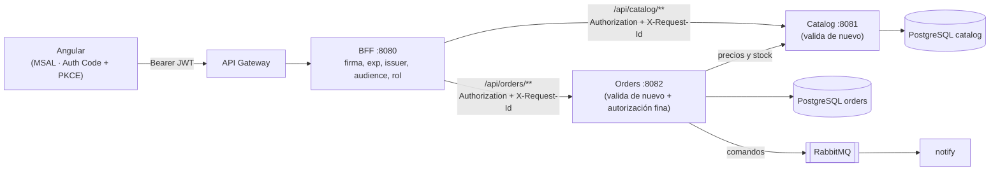

# ms-pedidos360-bff

Backend For Frontend de **Pedidos360** (DSY1107). Spring Boot 4.1.1 · Java 25 · puerto **8080**.
Único backend que ve el frontend; orquesta los microservicios (catálogo y pedidos).

## Arquitectura

Capas: `controller` → `service` → `client` (RestClient) · `config` (seguridad, JWT, CORS) · `exception` · `web` (X-Request-Id).

## Qué cubre de la evaluación
| Requisito | Implementación |
|---|---|
| BFF valida JWT igual que el API Manager | `JwtConfig`: firma (JWKS de Entra ID), `exp/nbf`, `issuer`, `audience` explícita |
| Solo permite consumir con token válido | `/api/**` exige `SCOPE_access_as_user`; públicos solo `/actuator/health` y Swagger |
| Autorización por rol | claim `roles` → `ROLE_Admin/Operador/Cliente`; con `ENFORCE_ROLES=true`: escribir en catálogo exige Admin/Operador, pedidos exige cualquiera de los 3 roles, borrar un pedido solo Admin (ver [Roles](#roles-enforce_rolestrue)) |
| Códigos de error adecuados | 401 / 403 JSON `{timestamp,status,error,mensaje,path}`; 400, 404, 409, 502, 503, 500 sin stacktrace |
| Integración con pedidos | `OrdersController` → `OrdersService` → `OrdersClient`: reenvía los 7 endpoints de ms-pedidos360-orders con sus códigos |

## Endpoints
| Método | Ruta | Destino |
|---|---|---|
| GET | `/api/catalog/products` | catálogo |
| GET | `/api/catalog/products/{id}` | catálogo |
| POST | `/api/catalog/products` | catálogo (201) |
| PUT | `/api/catalog/products/{id}` | catálogo |
| DELETE | `/api/catalog/products/{id}` | catálogo (204, borrado lógico; 404 si no existe o ya fue eliminado) |
| GET | `/api/catalog/products/eliminados` | catálogo (Admin/Operador con `ENFORCE_ROLES=true`) |
| PUT | `/api/catalog/products/{id}/restaurar` | catálogo (deshace el borrado lógico; Admin/Operador con `ENFORCE_ROLES=true`) |
| POST | `/api/orders` | pedidos (201) |
| GET | `/api/orders?estado=&desde=&hasta=&page=&size=` | pedidos (query params reenviados tal cual; solo los que vienen) |
| GET | `/api/orders/{id}` | pedidos |
| PUT | `/api/orders/{id}` | pedidos (dirección y/o ítems; solo en CREADO) |
| PUT | `/api/orders/{id}/status` | pedidos (`{"status":"ACEPTADO","comentario":"..."}`) |
| GET | `/api/orders/{id}/history` | pedidos |
| DELETE | `/api/orders/{id}` | pedidos (204, borrado lógico; solo Admin) |
| GET | `/actuator/health`, `/swagger-ui.html`, `/v3/api-docs` | público |

Los JSON de request/response de pedidos son los del contrato de orders (README de ms-pedidos360-orders, "Contrato para otros servicios"). El BFF solo valida la forma básica (`direccionEntrega` e `items` obligatorios, `productoId`/`cantidad` presentes, `status` presente); rangos, estados válidos y existencia de productos los valida orders y el BFF reenvía su 400.

### Traducción de errores
| Respuesta del microservicio | Catálogo | Pedidos |
|---|---|---|
| 400 | 400 con `detalles` | 400 con `detalles` |
| 401 / 403 | igual | igual |
| 404 | 404 (mensaje del BFF: "Producto no encontrado con id N") | 404 con el `mensaje` de orders |
| 409 (transición inválida, sin stock, conflicto de versión) | 502 | **409** con `mensaje` y `detalles` de orders tal cual (números incluidos) |
| 503 (p. ej. catalog caído detrás de orders) | 502 | **503** con el `mensaje` de orders |
| Otro 5xx o respuesta ilegible | 502 | 502 |
| Caído / timeout | 503 | 503 |

Los 404/409/503 se propagan solo en los clients que lo piden (`DownstreamRestClientFactory.create(servicio, url, PROPAGAR_NEGOCIO)`), así el comportamiento de catálogo no cambia.

```json
{"timestamp":"2026-10-20T15:04:05.123Z","status":409,"error":"Conflict",
 "mensaje":"No se puede despachar un pedido que no fue aceptado (estado actual: CREADO)",
 "detalles":{"estadoActual":"CREADO","estadoSolicitado":"DESPACHADO"},"path":"/api/orders/15/status"}
```

### Roles (`ENFORCE_ROLES=true`)
| Ruta | Exige (además del scope `access_as_user`) |
|---|---|
| GET `/api/catalog/**` | nada más |
| POST/PUT/DELETE `/api/catalog/**` | Admin u Operador |
| DELETE `/api/orders/**` | Admin |
| Resto de `/api/orders/**` | Admin, Operador o Cliente |

La autorización fina de pedidos (un Cliente solo ve y edita los suyos, solo puede cancelar en CREADO, qué transición hace cada rol) la aplica orders; el BFF no la duplica. Ojo: orders permite **crear y editar** solo a Cliente y Operador, así que un Admin pasa el BFF y recibe **403 de orders**. Con `ENFORCE_ROLES=false`, `/api/**` exige solo el scope.

## Variables de entorno
| Variable | Default |
|---|---|
| `ENTRA_ISSUER_URI` | `https://login.microsoftonline.com/0bfad962-b91d-465a-b769-8e71565efe7d/v2.0` |
| `ENTRA_API_CLIENT_ID` (audience) | `d80d5009-1b8a-49b2-a3da-08a8bbd00936` |
| `CATALOG_BASE_URL` | `http://localhost:8081` |
| `ORDERS_BASE_URL` | `http://localhost:8082` |
| `SERVICES_CONNECT_TIMEOUT` / `SERVICES_READ_TIMEOUT` | `2s` / `5s` |
| `ENFORCE_ROLES` | `false` |
| `CORS_ALLOWED_ORIGINS` | `http://localhost:4200` |

## Ejecutar
```bash
cd ../ms-pedidos360-catalog && ./mvnw spring-boot:run   # 8081 (requiere PostgreSQL, ver su README)
cd ../ms-pedidos360-orders  && ./mvnw spring-boot:run   # 8082 (requiere PostgreSQL y RabbitMQ, ver su README)
cd ../ms-pedidos360-bff     && ./mvnw spring-boot:run   # 8080
./mvnw clean verify                                     # tests (no requieren catálogo, pedidos ni Azure)
```

## Swagger (OpenAPI)
| | |
|---|---|
| URL | http://localhost:8080/swagger-ui.html |
| Spec JSON | `curl http://localhost:8080/v3/api-docs` |

Botón **Authorize** → pegar el `TOKEN` (sin `Bearer `) para probar los endpoints; sin token responden 401.

## Pruebas manuales (curl)

`TOKEN`: access token de Entra ID (scope `api://d80d5009-1b8a-49b2-a3da-08a8bbd00936/access_as_user`).
Iniciar sesión en el frontend → DevTools → Network → llamada a `/api/...` → header `Authorization` (lo que va tras `Bearer `).

### Local (`http://localhost:8080`)
```bash
BASE=http://localhost:8080
TOKEN="<access token>"

curl -i $BASE/actuator/health                                              # 200 público
curl -i $BASE/api/catalog/products                                         # 401 {"mensaje":"Token ausente, inválido o expirado",...}
curl -i -H "Authorization: Bearer abc.def.ghi" $BASE/api/catalog/products  # 401
curl -i -H "Authorization: Bearer $TOKEN" $BASE/api/catalog/products       # 200 lista JSON + header X-Request-Id
curl -i -H "Authorization: Bearer $TOKEN" $BASE/api/catalog/products/1     # 200
curl -i -H "Authorization: Bearer $TOKEN" $BASE/api/catalog/products/99999 # 404
curl -i -H "Authorization: Bearer $TOKEN" $BASE/api/catalog/products/abc   # 400 id inválido

curl -i -X POST $BASE/api/catalog/products \
  -H "Authorization: Bearer $TOKEN" -H "Content-Type: application/json" \
  -d '{"nombre":"Teclado","descripcion":"Mecanico USB","precio":49990,"stock":10}'  # 201 (repetir → 400 duplicado)

curl -i -X POST $BASE/api/catalog/products \
  -H "Authorization: Bearer $TOKEN" -H "Content-Type: application/json" \
  -d '{"nombre":"","precio":-1,"stock":-5}'                                         # 400 con "detalles"

# Borrado lógico (con ENFORCE_ROLES=true el token debe tener rol Admin u Operador)
curl -i -X DELETE -H "Authorization: Bearer $TOKEN" $BASE/api/catalog/products/4  # 204 (repetir → 404)

# Con el catálogo apagado:
curl -i -H "Authorization: Bearer $TOKEN" $BASE/api/catalog/products       # 503 "Servicio de catálogo no disponible"
```

### Flujo de pedidos a través del BFF
Crear y editar: token con rol **Cliente** u Operador. Aceptar → entregar: **Operador** o Admin. Borrar: **Admin**.
```bash
BASE=http://localhost:8080
CLIENTE="<token con rol Cliente>"
OPERADOR="<token con rol Operador>"
H='Content-Type: application/json'

# Crear (201, queda en CREADO; precios desde catalog)
curl -i -X POST $BASE/api/orders -H "Authorization: Bearer $CLIENTE" -H "$H" -H "X-Request-Id: demo-1" \
  -d '{"direccionEntrega":"Av. Providencia 1234, Santiago","items":[{"productoId":1,"cantidad":2},{"productoId":4,"cantidad":1}]}'
ID=15   # el "id" de la respuesta

# Editar mientras está en CREADO (200)
curl -i -X PUT $BASE/api/orders/$ID -H "Authorization: Bearer $CLIENTE" -H "$H" \
  -d '{"direccionEntrega":"Los Leones 456, Providencia"}'

# 409: despachar sin haber aceptado
curl -i -X PUT $BASE/api/orders/$ID/status -H "Authorization: Bearer $OPERADOR" -H "$H" -d '{"status":"DESPACHADO"}'

# Aceptar (descuenta stock en catalog; 409 con detalles si no alcanza) → preparar → despachar → entregar
for S in ACEPTADO EN_PREPARACION DESPACHADO ENTREGADO; do
  curl -s -X PUT $BASE/api/orders/$ID/status -H "Authorization: Bearer $OPERADOR" -H "$H" -d "{\"status\":\"$S\"}"; echo
done

curl -i $BASE/api/orders/$ID -H "Authorization: Bearer $CLIENTE"                        # 200 ENTREGADO
curl -i "$BASE/api/orders?estado=ENTREGADO&page=0&size=10" -H "Authorization: Bearer $OPERADOR"   # 200 paginado
curl -i $BASE/api/orders/$ID/history -H "Authorization: Bearer $OPERADOR"               # 200 (5 cambios)
curl -i $BASE/api/orders/99999 -H "Authorization: Bearer $OPERADOR"                     # 404 mensaje de orders

# Cancelar: el Cliente, solo su pedido en CREADO
curl -i -X PUT $BASE/api/orders/<otro-id>/status -H "Authorization: Bearer $CLIENTE" -H "$H" \
  -d '{"status":"CANCELADO","comentario":"Me equivoqué de dirección"}'

# Borrar (204, solo Admin; con ENFORCE_ROLES=true un Cliente u Operador recibe 403 del BFF)
curl -i -X DELETE $BASE/api/orders/<otro-id> -H "Authorization: Bearer <token Admin>"

# Con orders apagado:
curl -i $BASE/api/orders -H "Authorization: Bearer $OPERADOR"                            # 503 "Servicio de pedidos no disponible"
```


## Agregar un microservicio
Propiedad `pedidos360.services.<ms>.base-url` → DTOs propios → `client/<Ms>Client` con `DownstreamRestClientFactory` (ya aporta timeouts, propagación de token/X-Request-Id y traducción de errores) → `service` + `controller` con el mismo path (`/api/<ms>/...`). Si sus 404/409/503 deben llegar al front tal cual, crear el client con `PROPAGAR_NEGOCIO` (como orders). El scope ya lo cubre `/api/**`; las reglas por rol se agregan en `SecurityConfig`.
